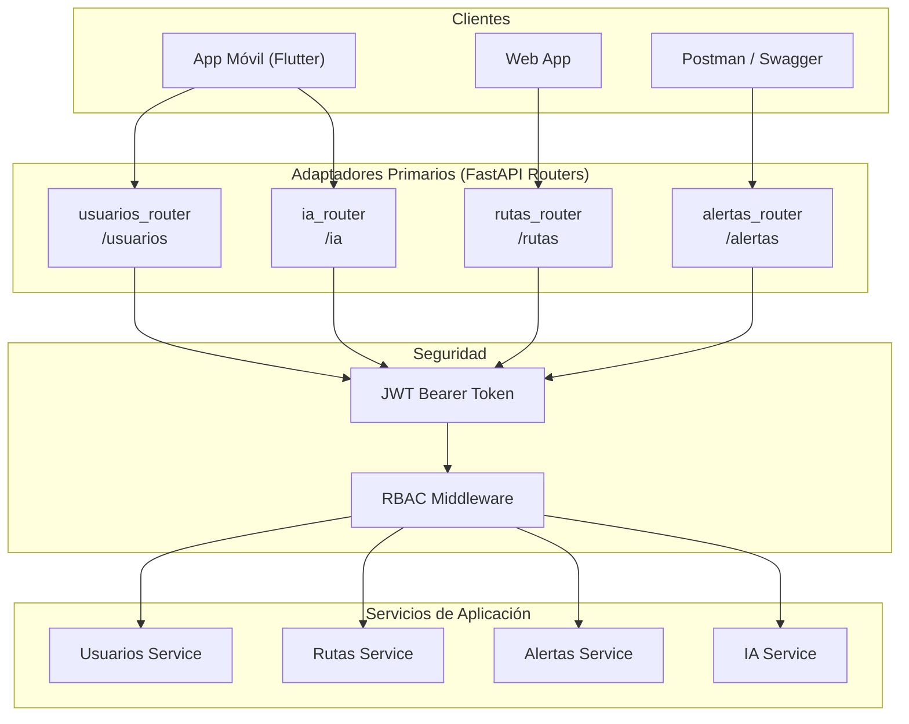

# 🔌 Adaptadores Primarios (Inbound / Driving Adapters)

> **Patrón:** Arquitectura Hexagonal — Adaptadores de Entrada  
> **Tecnología:** FastAPI / Python 3.11+  
> **Responsabilidad:** Recibir solicitudes HTTP, validar payloads y delegar a servicios de aplicación.  

---

## 1. Visión General

Los **adaptadores primarios** son los puntos de entrada del sistema. En TuRutaMed, corresponden a los **routers FastAPI** que exponen endpoints REST protegidos por autenticación JWT. Su única responsabilidad es traducir protocolos HTTP/JSON a llamadas de los servicios de aplicación, delegando toda la lógica de negocio al núcleo de dominio.

**Principio inviolable:** Los adaptadores primarios **no contienen lógica de negocio**. Solo validan, autentican y delegan.

---

## 2. Diagrama de Adaptadores Primarios



---

## 3. Catálogo de Adaptadores Primarios

### 3.1. `usuarios_router` — Gestión de Identidades

- **Archivo:** `app/routers/usuarios_router.py`
- **Prefijo:** `/usuarios`
- **Responsabilidad:** Registro, autenticación y gestión de usuarios con control de acceso por roles (RBAC).

| Endpoint | Método | Descripción | Autenticación | Roles Permitidos |
| :--- | :--- | :--- | :--- | :--- |
| `/usuarios/registro` | `POST` | Registro de nuevo usuario | No | Público |
| `/usuarios/login` | `POST` | Autenticación y emisión de JWT | No | Público |
| `/usuarios/perfil` | `GET` | Consulta del perfil del usuario autenticado | Sí (Bearer JWT) | `pasajero`, `operador`, `administrador` |
| `/usuarios/` | `GET` | Listado de usuarios | Sí (Bearer JWT) | `administrador` |

**DTOs (Pydantic):**
- `UsuarioRegistro`: `email`, `password`, `nombre`, `rol`
- `UsuarioLogin`: `email`, `password`
- `UsuarioRespuesta`: `id`, `email`, `nombre`, `rol`, `activo`, `fecha_registro`

**Validaciones:**
- Email con formato válido y único en base de datos.
- Contraseña con longitud mínima y hashing con `bcrypt`.
- Rol asignado según permisos del solicitante.

---

### 3.2. `rutas_router` — Consulta de Rutas y Paraderos

- **Archivo:** `app/routers/rutas_router.py`
- **Prefijo:** `/rutas`
- **Responsabilidad:** Consulta de rutas, paraderos georreferenciados y filtrado por accesibilidad.

| Endpoint | Método | Descripción | Autenticación | Roles Permitidos |
| :--- | :--- | :--- | :--- | :--- |
| `/rutas/` | `GET` | Listado de rutas disponibles | Sí (Bearer JWT) | `pasajero`, `operador`, `administrador` |
| `/rutas/{id}` | `GET` | Detalle de una ruta específica | Sí (Bearer JWT) | `pasajero`, `operador`, `administrador` |
| `/rutas/cercanas` | `GET` | Rutas/paraderos cercanos a coordenadas | Sí (Bearer JWT) | `pasajero`, `operador`, `administrador` |
| `/rutas/accesibles` | `GET` | Rutas con filtro de accesibilidad PMR | Sí (Bearer JWT) | `pasajero`, `operador`, `administrador` |

**DTOs (Pydantic):**
- `RutaCreate`: `nombre_ruta`, `tipo_transporte`, `origen`, `destino`, `tiempo_estimado_minutos`, `coordenadas`
- `RutaRespuesta`: `id`, `nombre_ruta`, `tipo_transporte`, `origen`, `destino`, `tiempo_estimado_minutos`, `coordenadas`, `paraderos`

**Validaciones:**
- Coordenadas en formato `[longitud, latitud]` (GeoJSON).
- `tiempo_estimado_minutos` entero positivo.
- Filtro de accesibilidad valida el atributo `accesible` de `RutaAccesible`.

---

### 3.3. `alertas_router` — Reportes y Alertas Viales

- **Archivo:** `app/routers/alertas_router.py`
- **Prefijo:** `/alertas`
- **Responsabilidad:** Reporte y consulta de incidentes viales geoespaciales (Modo Waze).

| Endpoint | Método | Descripción | Autenticación | Roles Permitidos |
| :--- | :--- | :--- | :--- | :--- |
| `/alertas/` | `POST` | Reportar nueva alerta vial | Sí (Bearer JWT) | `pasajero`, `operador`, `administrador` |
| `/alertas/` | `GET` | Listado de alertas activas | Sí (Bearer JWT) | `pasajero`, `operador`, `administrador` |
| `/alertas/cercanas` | `GET` | Alertas cercanas a coordenadas | Sí (Bearer JWT) | `pasajero`, `operador`, `administrador` |
| `/alertas/{id}` | `DELETE` | Eliminar alerta (moderación) | Sí (Bearer JWT) | `operador`, `administrador` |

**DTOs (Pydantic):**
- `AlertaCreate`: `tipo_incidencia`, `descripcion`, `coordenadas`, `nombre_ruta` (opcional)
- `AlertaRespuesta`: `id`, `tipo_incidencia`, `descripcion`, `coordenadas`, `fecha_reporte`, `nombre_ruta`

**Validaciones:**
- `tipo_incidencia` dentro de enumeración: `congestion`, `siniestro`, `desvio`, `bloqueo`, `obra`.
- Coordenadas en formato `[longitud, latitud]`.
- `fecha_reporte` generada automáticamente en ISO 8601.

---

### 3.4. `ia_router` — Recomendaciones Multimodales con IA

- **Archivo:** `app/routers/ia_router.py`
- **Prefijo:** `/ia`
- **Responsabilidad:** Endpoints de optimización de itinerarios asistida por Google Gemini AI.

| Endpoint | Método | Descripción | Autenticación | Roles Permitidos |
| :--- | :--- | :--- | :--- | :--- |
| `/ia/optimizar-ruta` | `POST` | Solicitar plan multimodal optimizado | Sí (Bearer JWT) | `pasajero`, `operador`, `administrador` |
| `/ia/analizar-congestion` | `POST` | Análisis predictivo de congestión vial | Sí (Bearer JWT) | `operador`, `administrador` |

**DTOs (Pydantic):**
- `OptimizarRutaRequest`: `origen`, `destino`, `preferencias` (opcional)
- `OptimizarRutaResponse`: `secuencia_rutas`, `duracion_estimada`, `recomendacion_ia`

**Validaciones:**
- `origen` y `destino` no vacíos.
- `preferencias` opcional: `["accesible", "rapido", "economico"]`.

---

## 4. Flujo de Procesamiento de una Solicitud HTTP

```
1. Cliente envía HTTP Request (JSON)
2. FastAPI Router recibe la solicitud
3. Pydantic valida el payload (DTO)
4. JWT Bearer Token se verifica (seguridad)
5. RBAC valida el rol del usuario
6. Router invoca el Servicio de Aplicación correspondiente
7. Servicio orquesta entidades de dominio y adaptadores secundarios
8. Respuesta se formatea como JSON
9. HTTP Response se envía al cliente
```

---

## 5. Manejo de Errores en Adaptadores Primarios

Todos los routers delegan el manejo de excepciones al **Exception Handler** centralizado (`app/core/exceptions.py`):

| Excepción | Código HTTP | Descripción |
| :--- | :--- | :--- |
| `RequestValidationError` | 422 | Payload inválido o campos faltantes |
| `HTTPException` (401) | 401 | Token JWT inválido o expirado |
| `HTTPException` (403) | 403 | Rol insuficiente para la operación |
| `HTTPException` (404) | 404 | Recurso no encontrado |
| `PyMongoError` | 500 | Error de base de datos MongoDB |
| `SQLAlchemyError` | 500 | Error de base de datos MySQL |

---

## 6. Convenciones de Implementación

1. **Sin lógica de negocio:** Los routers solo validan y delegan.
2. **Inyección de dependencias:** Uso de `Depends()` para DB sessions y autenticación.
3. **Documentación automática:** FastAPI genera Swagger/OpenAPI en `/docs` y `/redoc`.
4. **Tipado estricto:** Todos los parámetros y respuestas con type hints.
5. **Versionado:** Prefijo `/api/v1/` recomendado para evolución futura.