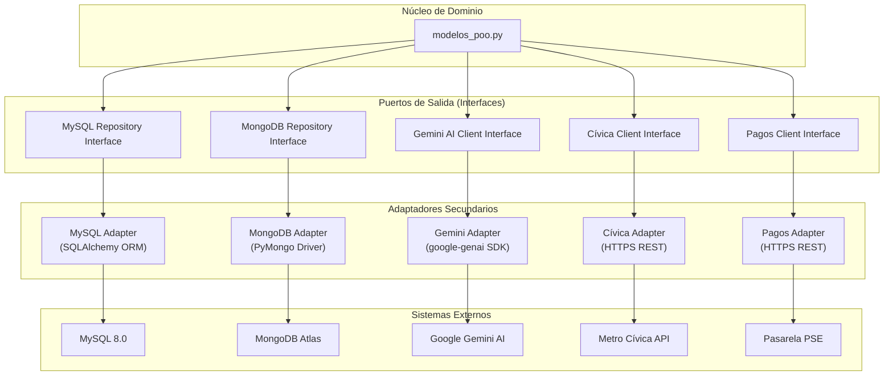

# 🔌 Adaptadores Secundarios (Outbound / Driven Adapters)

> **Patrón:** Arquitectura Hexagonal — Adaptadores de Salida  
> **Tecnología:** SQLAlchemy, PyMongo, `google-genai`, HTTPS REST  
> **Responsabilidad:** Implementar puertos de salida, persistir datos y comunicarse con sistemas externos.  

---

## 1. Visión General

Los **adaptadores secundarios** son los componentes que el núcleo de dominio necesita para persistir información o comunicarse con servicios externos. En TuRutaMed, corresponden a los conectores de bases de datos (MySQL, MongoDB) y los clientes HTTP/SDK para APIs externas (Gemini, Cívica, Pasarela de Pagos).

**Principio inviolable:** Los adaptadores secundarios **implementan interfaces (puertos) definidas por el dominio**. El dominio nunca conoce las implementaciones concretas.

---

## 2. Diagrama de Adaptadores Secundarios



---

## 3. Catálogo de Adaptadores Secundarios

### 3.1. MySQL Adapter — Persistencia Relacional

- **Archivo:** `app/models/usuario.py`
- **Tecnología:** SQLAlchemy ORM / PyMySQL Driver
- **Base de Datos:** MySQL 8.0
- **Responsabilidad:** Persistencia ACID de usuarios, credenciales y roles RBAC.

**Modelo ORM:**
```python
class Usuario(Base):
    __tablename__ = "usuarios"
    id: int = Column(Integer, primary_key=True, index=True)
    email: str = Column(String(255), unique=True, index=True, nullable=False)
    contrasena_encrip: str = Column(String(255), nullable=False)
    nombre: str = Column(String(100), nullable=False)
    rol: str = Column(String(50), default="pasajero", nullable=False)
    activo: bool = Column(Boolean, default=True)
    fecha_registro: datetime = Column(DateTime, default=datetime.utcnow)
```

**Operaciones:**
- `crear_usuario(db, usuario_data)`: Inserta nuevo usuario con contraseña hasheada.
- `obtener_usuario_por_email(db, email)`: Consulta usuario por email (autenticación).
- `actualizar_rol(db, usuario_id, nuevo_rol)`: Modifica rol (RBAC).
- `desactivar_usuario(db, usuario_id)`: Soft delete de cuenta.

**Gestión de Conexión:**
- Sesiones unitarias inyectadas vía `Depends(get_mysql_db)`.
- Pool de conexiones configurado en `app/database.py`.
- Transacciones con `commit`/`rollback` automático.

---

### 3.2. MongoDB Adapter — Persistencia Documental y Geoespacial

- **Archivos:** `app/models/ruta_mongo.py`, `app/models/alerta_mongo.py`
- **Tecnología:** PyMongo Driver / MongoDB Atlas
- **Base de Datos:** MongoDB Atlas (Cloud)
- **Responsabilidad:** Persistencia de rutas, paraderos, alertas y consultas geoespaciales.

**Colección `rutas`:**
```json
{
  "_id": "ObjectId",
  "nombre_ruta": "Manrique Oriental - Centro (Integrado)",
  "tipo_transporte": "Bus Colectivo",
  "origen": "Manrique Oriental",
  "destino": "Estación Parque Berrio",
  "tiempo_estimado_minutos": 25,
  "coordenadas": [-75.5583, 6.2705],
  "paraderos": [
    { "nombre": "Paradero Manrique", "coordenadas": [-75.5590, 6.2710] },
    { "nombre": "Paradero Centro", "coordenadas": [-75.5630, 6.2520] }
  ],
  "accesible": true,
  "horario": "05:00 - 23:00"
}
```

**Colección `alertas`:**
```json
{
  "_id": "ObjectId",
  "tipo_incidencia": "Congestión / Taco",
  "descripcion": "Tráfico pesado por obra en la Oriental",
  "coordenadas": [-75.5636, 6.2518],
  "nombre_ruta": "Manrique Oriental - Centro (Integrado)",
  "fecha_reporte": "2026-10-17T14:30:00Z"
}
```

**Índices Geoespaciales:**
- `2dsphere` sobre el campo `coordenadas` en ambas colecciones.
- Permite consultas `$near`, `$geoWithin`, `$maxDistance`.

**Operaciones:**
- `insertar_ruta(db, ruta_data)`: Inserta documento de ruta.
- `consultar_rutas_cercanas(db, lon, lat, max_dist)`: Búsqueda radial con `$near`.
- `insertar_alerta(db, alerta_data)`: Inserta alerta vial.
- `consultar_alertas_cercanas(db, lon, lat, max_dist)`: Alertas en radio de proximidad.

**Gestión de Conexión:**
- Cliente PyMongo compartido configurado en `app/database.py`.
- Reconexión automática ante fallos de red.
- Timeouts configurables para operaciones de lectura/escritura.

---

### 3.3. Gemini Adapter — Inteligencia Artificial Generativa

- **Archivo:** `app/services/gemini_service.py`
- **Tecnología:** SDK `google-genai` (modelo `gemini-2.5-flash`)
- **Responsabilidad:** Optimización de itinerarios multimodales y análisis predictivo de congestión.

**Interfaz (Puerto de Salida):**
```python
class GeminiClientInterface(Protocol):
    def optimizar_itinerario(self, origen: str, destino: str, alertas: List[str]) -> str: ...
    def analizar_congestion(self, alertas: List[dict]) -> str: ...
```

**Implementación:**
- Construye prompts contextuales con telemetría vial y alertas ciudadanas.
- Envía la solicitud al modelo `gemini-2.5-flash` vía HTTPS.
- Parsea la respuesta generativa y la mapea a entidades de dominio (`ViajeMultimodal`).
- Maneja errores de cuota, timeout y respuestas malformadas.

**Configuración:**
- API Key inyectada vía variable de entorno `GEMINI_API_KEY`.
- Modelo configurable: `gemini-2.5-flash` (por defecto).
- Timeout de solicitud: 30 segundos.

---

### 3.4. Cívica Adapter — Consulta de Saldo y Recarga

- **Archivo:** `app/services/civica_service.py`
- **Tecnología:** HTTPS REST (cliente `httpx` o `requests`)
- **Responsabilidad:** Consulta de saldo en tiempo real y procesamiento de recargas de tarjeta Cívica.

**Interfaz (Puerto de Salida):**
```python
class CivicaClientInterface(Protocol):
    def consultar_saldo(self, numero_tarjeta: str) -> float: ...
    def recargar_saldo(self, numero_tarjeta: str, monto: float, metodo_pago: str) -> bool: ...
```

**Endpoints Consumidos:**
- `GET /civica/saldo/{numero_tarjeta}`: Consulta saldo disponible.
- `POST /civica/recarga`: Acredita saldo a la tarjeta.

**Seguridad:**
- Autenticación mediante API Key o certificado mTLS.
- Credenciales inyectadas vía variables de entorno.
- Validación de respuesta con códigos HTTP semánticos.

---

### 3.5. Pagos Adapter — Procesamiento de Recargas Monetarias

- **Archivo:** `app/services/pagos_service.py`
- **Tecnología:** HTTPS REST (cliente `httpx` o `requests`)
- **Responsabilidad:** Integración con pasarela de pagos (PSE/Redeban) para recargas de saldo.

**Interfaz (Puerto de Salida):**
```python
class PagosClientInterface(Protocol):
    def procesar_pago(self, monto: float, metodo_pago: str, referencia: str) -> dict: ...
    def verificar_transaccion(self, transaccion_id: str) -> bool: ...
```

**Flujo de Recarga:**
```
1. Usuario solicita recarga (monto, método de pago)
2. Pagos Adapter envía solicitud a pasarela PSE
3. Pasarela procesa el pago y retorna transacción
4. Cívica Adapter acredita saldo a la tarjeta
5. Se retorna confirmación al usuario
```

**Seguridad:**
- Webhooks firmados para confirmación de pago.
- Validación de firma HMAC-SHA256.
- Reintentos con backoff exponencial ante fallos transitorios.

---

## 4. Gestión de Conexiones y Resiliencia

### 4.1. Pool de Conexiones

| Adaptador | Pool Size | Max Overflow | Timeout |
| :--- | :--- | :--- | :--- |
| MySQL (SQLAlchemy) | 5 | 10 | 30s |
| MongoDB (PyMongo) | 10 | 20 | 10s |
| Gemini (httpx) | 1 (async) | N/A | 30s |
| Cívica (httpx) | 2 | N/A | 15s |
| Pagos (httpx) | 2 | N/A | 15s |

### 4.2. Estrategia de Reintentos

- **Bases de datos:** Reintentos con backoff exponencial (3 intentos, 1s, 2s, 4s).
- **APIs externas:** Reintentos con backoff exponencial (3 intentos, 2s, 4s, 8s).
- **Circuit Breaker:** Implementado para Gemini AI y Pasarela de Pagos (umbral: 5 fallos consecutivos, reset: 60s).

### 4.3. Manejo de Errores

- Todos los adaptadores secundarios capturan excepciones específicas y las traducen a excepciones de dominio.
- Los errores de infraestructura se registran en logs estructurados (JSON).
- Se expone un endpoint `/health` para monitoreo de dependencias externas.

---

## 5. Convenciones de Implementación

1. **Implementación de Interfaces:** Cada adaptador implementa una interfaz (Protocol) definida en el dominio o servicios.
2. **Inyección de Dependencias:** Los adaptadores se inyectan en los servicios vía FastAPI `Depends()`.
3. **Configuración Externa:** Credenciales y URLs se inyectan vía variables de entorno (`.env`).
4. **Logging Estructurado:** Todos los adaptadores registran operaciones en formato JSON.
5. **Testing:** Cada adaptador tiene pruebas unitarias con mocks de las dependencias externas.