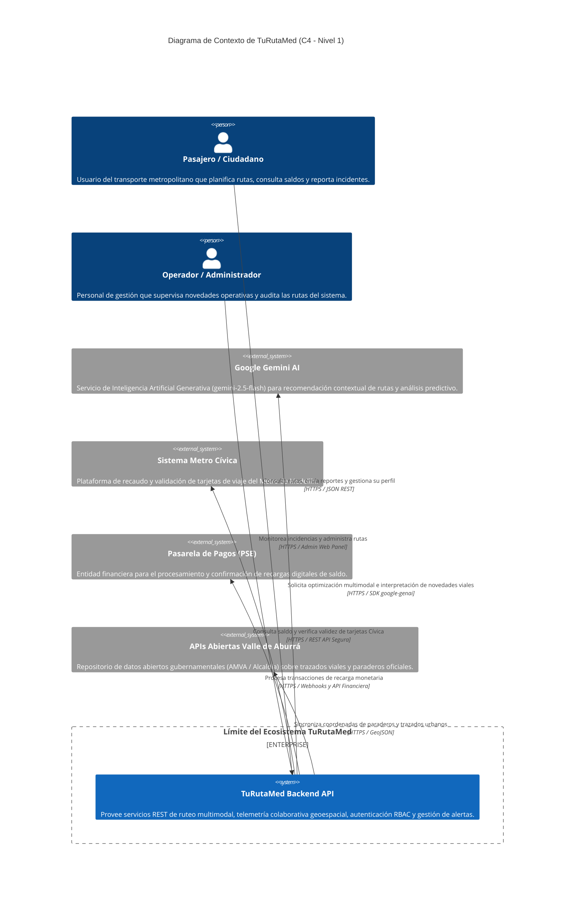

# 🌐 C4 Architecture - Nivel 1: Diagrama de Contexto del Sistema

> **Sistema:** TuRutaMed (Sistema de Información y Gestión de Transporte Multimodal)  
> **Alcance:** Área Metropolitana del Valle de Aburrá (Medellín, Antioquia)  
> **Nivel de Abstracción:** C4 Nivel 1 - System Context  

---

## 1. Descripción del Sistema

El diagrama de contexto sitúa a **TuRutaMed** dentro de su entorno operativo, identificando a los usuarios humanos directos y los sistemas externos con los que interactúa para proporcionar una experiencia de movilidad inteligente e integrada.

TuRutaMed actúa como el concentrador central que procesa telemetría colaborativa, cálculo de rutas, consultas de saldo y optimización de itinerarios multimodales con asistencia de inteligencia artificial.

---

## 2. Diagrama de Contexto (Mermaid C4)

---

## 3. Catálogo de Actores y Sistemas

### 3.1. Actores (Personas)

| Actor | Rol | Interacción con TuRutaMed |
| :--- | :--- | :--- |
| **Pasajero / Ciudadano** | Usuario Final | Consulta rutas de bus y metro, verifica tiempos estimados de llegada, reporta incidentes de tránsito (Modo Waze), revisa y recarga saldo Cívica y filtra por accesibilidad física. |
| **Operador / Administrador** | Personal Técnico / Supervisor | Gestiona altas y bajas de rutas en el sistema, modera alertas ciudadanas reportadas y valida la consistencia de los datos operativos. |

---

### 3.2. Sistema Principal

- **TuRutaMed Backend API:**
  - Servidor central construido sobre **FastAPI**, **MongoDB** y **MySQL**.
  - Responsable de exponer interfaces REST protegidas con autenticación basada en tokens JWT.
  - Implementa un motor geoespacial con soporte de indexación `2dsphere` para búsquedas radiales de proximidad.
  - Alberga las 10 reglas de negocio POO unificadas del dominio metropolitano.

---

### 3.3. Sistemas Externos e Interfaces

| Sistema Externo | Tipo | Protocolo / Contrato | Propósito dentro del Ecosistema |
| :--- | :--- | :--- | :--- |
| **Google Gemini AI (`google-genai`)** | Servicio Cloud de IA | HTTPS / JSON (SDK oficial) | Optimización heurística de planes multimodales (`ViajeMultimodal`), síntesis de congestión vial a partir de alertas ciudadanas y recomendaciones contextuales para el pasajero. |
| **Sistema Metro Cívica** | Core Bancario / Recaudo | HTTPS / Mutual TLS (mTLS) | Consulta en tiempo real del saldo disponible de la tarjeta (`TarjetaCivica`) y validación de identidad del titular en la red masiva Metro. |
| **Pasarela de Pagos (PSE / Redeban)** | Gateway Financiero | HTTPS / REST Webhooks | Ejecución y acreditación monetaria de transacciones seguras para recargas de saldo (`RecargaCivica`). |
| **APIs Abiertas Valle de Aburrá (AMVA)** | Open Data Gubernamental | HTTPS / GeoJSON REST | Ingesta y normalización de paraderos, polígonos de cobertura de comunas y paradas habilitadas para personas con movilidad reducida (PMR). |

---

## 4. Límites de Seguridad y Fronteras de Confianza

1. **Canal Seguro de Clientes:** Toda comunicación desde aplicaciones móviles (Flutter/Android/iOS) o web se efectúa mediante túneles seguros cifrados **TLS 1.3**.
2. **Autenticación y Autorización:**
   - Mecanismo **OAuth2 / Bearer JWT** con firma criptográfica simétrica `HS256`.
   - Control de acceso por roles (**RBAC**): `pasajero`, `operador` y `administrador`.
3. **Aislamiento de Terceros:** Las credenciales de integración para Google Gemini API, credenciales de base de datos y llaves de la pasarela de pagos se inyectan estrictamente a través de variables de entorno (`.env`) validadas en el inicio del servidor.
