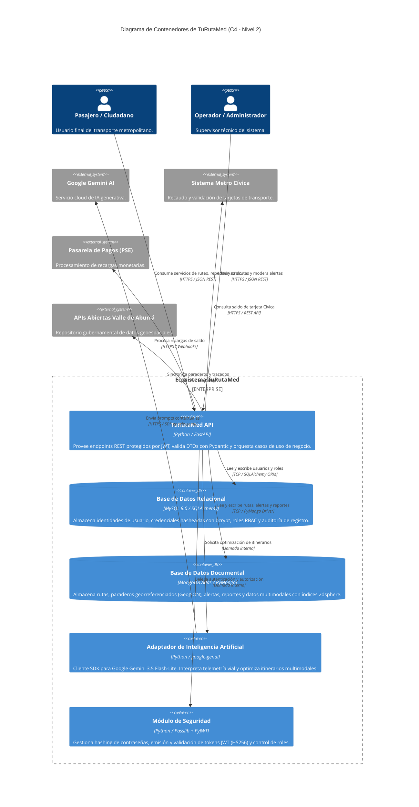

# 📦 C4 Architecture - Nivel 2: Diagrama de Contenedores

> **Sistema:** TuRutaMed Backend  
> **Nivel de Abstracción:** C4 Nivel 2 - Containers  
> **Alcance:** Aplicaciones, APIs, almacenes de persistencia y servicios externos que componen la solución.  

---

## 1. Descripción del Nivel

El diagrama de contenedores descompone el sistema TuRutaMed Backend en sus principales unidades de despliegue (contenedores), mostrando cómo interactúan entre sí y con sistemas externos. Cada contenedor representa una aplicación ejecutable, una base de datos o un servicio de infraestructura autónomo.

---

## 2. Diagrama de Contenedores (Mermaid C4)

---

## 3. Catálogo de Contenedores

### 3.1. TuRutaMed API (Contenedor Principal)
- **Tecnología:** Python 3.11+ / FastAPI / Uvicorn
- **Responsabilidad:**
  - Exponer endpoints REST documentados mediante OpenAPI/Swagger.
  - Validar payloads de entrada/salida con Pydantic (DTOs).
  - Orquestar casos de uso invocando puertos del dominio y adaptadores secundarios.
  - Manejar excepciones centralizadas con códigos REST semánticos.
- **Puertos de Entrada:** `/usuarios`, `/rutas`, `/alertas`, `/ia`, `/` (health check).
- **Protocolo:** HTTPS (TLS 1.3) en producción; HTTP en desarrollo local.

### 3.2. Base de Datos Relacional (MySQL 8.0)
- **Tecnología:** MySQL 8.0 / SQLAlchemy ORM / PyMySQL Driver
- **Responsabilidad:**
  - Garantizar propiedades ACID para identidades de usuario.
  - Almacenar credenciales cifradas con `bcrypt` y control de acceso por roles (RBAC).
  - Auditoría de registro y estados de cuenta.
- **Esquema Principal:** Tabla `usuarios` (`id` PK, `email` unique, `contrasena_encrip`, `rol`, `activo`, `fecha_registro`).
- **Acceso:** Sesiones unitarias inyectadas mediante `get_mysql_db` (`Depends` de FastAPI).

### 3.3. Base de Datos Documental (MongoDB Atlas)
- **Tecnología:** MongoDB Atlas Cloud / PyMongo Driver
- **Responsabilidad:**
  - Almacenar documentos complejos y anidados: geometrías de rutas, paraderos ordenados, incidencias.
  - Soportar consultas geoespaciales de proximidad (`$near`, `$geometry: Point`, `$maxDistance`).
  - Alta concurrencia de lectura/escritura para datos de telemetría en tiempo real.
- **Colecciones:** `rutas`, `alertas` (con índice `2dsphere`).
- **Acceso:** Cliente PyMongo compartido con gestión de conexión en `app/database.py`.

### 3.4. Módulo de Seguridad (Auth)
- **Tecnología:** Passlib (bcrypt) / PyJWT / Python-Jose
- **Responsabilidad:**
  - Hashing y verificación de contraseñas con salazón adaptativa.
  - Generación y decodificación de tokens JWT firmados con `HS256`.
  - Validación de roles (`pasajero`, `operador`, `administrador`) en endpoints protegidos.
- **Integración:** Inyectado como dependencia en routers que requieren autenticación.

### 3.5. Adaptador de Inteligencia Artificial
- **Tecnología:** Python / SDK `google-genai` (modelo `gemini-3.5-flash-lite`)
- **Responsabilidad:**
  - Construir prompts contextuales con telemetría vial y alertas ciudadanas.
  - Solicitar al modelo la optimización de itinerarios multimodales (`ViajeMultimodal`).
  - Interpretar respuestas generativas y mapearlas a entidades de dominio.
- **Integración:** Servicio de aplicación invocado por los routers de IA (`app/routers/ia_router.py`).

---

## 4. Tecnologías y Decisiones de Infraestructura

| Contenedor | Imagen / Runtime | Puerto Interno | Persistencia |
| :--- | :--- | :--- | :--- |
| TuRutaMed API | `python:3.11-slim` + Uvicorn | 8000 | Ephemeral |
| MySQL 8.0 | `mysql:8.0` | 3306 | Volumen persistente |
| MongoDB Atlas | Cluster Cloud | 27017 | Cloud (Replica Set) |
| Módulo de Seguridad | In-process (librería) | N/A | N/A |
| Adaptador IA | In-process (librería) | N/A | N/A |

---

## 5. Comunicación entre Contenedores

- **Síncrona:** HTTP/HTTPS REST entre API y sistemas externos.
- **Interna:** Llamadas directas en proceso (Python) entre routers, servicios y adaptadores.
- **Asíncrona (futuro):** Colas de mensajes (RabbitMQ/Kafka) para procesamiento de alertas masivas y notificaciones push.
- **Persistencia:** Conexiones TCP directas gestionadas por SQLAlchemy (MySQL) y PyMongo (MongoDB).