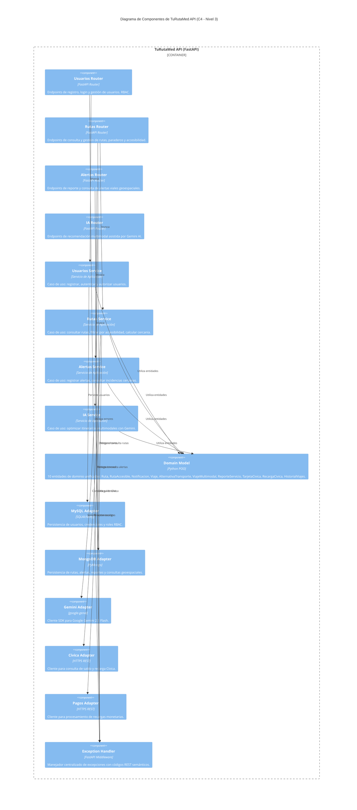

# ⚙️ C4 Architecture - Nivel 3: Diagrama de Componentes

> **Sistema:** TuRutaMed Backend  
> **Nivel de Abstracción:** C4 Nivel 3 - Components  
> **Alcance:** Descomposición interna del contenedor TuRutaMed API en componentes, puertos y adaptadores.  

---

## 1. Descripción del Nivel

El diagrama de componentes descompone el contenedor **TuRutaMed API** en sus componentes internos, siguiendo los principios de **Arquitectura Hexagonal (Ports & Adapters)**. Se distinguen:

- **Adaptadores Primarios:** Routers FastAPI que reciben solicitudes HTTP.
- **Núcleo de Aplicación (Puertos/Servicios):** Servicios de aplicación y casos de uso.
- **Núcleo de Dominio:** Entidades POO y reglas de negocio (`app/domain/modelos_poo.py`).
- **Adaptadores Secundarios:** Conectores a bases de datos y APIs externas.

---

## 2. Diagrama de Componentes (Mermaid C4)



---

## 3. Catálogo de Componentes Internos

### 3.1. Adaptadores Primarios (Inbound)

| Componente | Archivo Fuente | Responsabilidad |
| :--- | :--- | :--- |
| `Usuarios Router` | `app/routers/usuarios_router.py` | Endpoints de registro, login y gestión de usuarios con validación RBAC. |
| `Rutas Router` | `app/routers/rutas_router.py` | Endpoints de consulta de rutas, paraderos y filtrado por accesibilidad. |
| `Alertas Router` | `app/routers/alertas_router.py` | Endpoints de reporte y consulta de alertas viales geoespaciales. |
| `IA Router` | `app/routers/ia_router.py` | Endpoints de recomendación multimodal asistida por Gemini AI. |

### 3.2. Servicios de Aplicación (Puertos de Entrada / Use Cases)

| Componente | Archivo Fuente | Responsabilidad |
| :--- | :--- | :--- |
| `Usuarios Service` | `app/services/usuarios_service.py` | Orquestación de registro, autenticación y autorización de usuarios. |
| `Rutas Service` | `app/services/rutas_service.py` | Orquestación de consulta de rutas, cercanía y accesibilidad. |
| `Alertas Service` | `app/services/alertas_service.py` | Orquestación de registro y consulta de alertas viales. |
| `IA Service` | `app/services/ia_service.py` | Orquestación de optimización de itinerarios con Gemini AI. |

### 3.3. Núcleo de Dominio

| Componente | Archivo Fuente | Responsabilidad |
| :--- | :--- | :--- |
| `Domain Model` | `app/domain/modelos_poo.py` | 10 entidades POO unificadas: `Ruta`, `RutaAccesible`, `Notificacion`, `Viaje`, `AlternativaTransporte`, `ViajeMultimodal`, `ReporteServicio`, `TarjetaCivica`, `RecargaCivica`, `HistorialViajes`. |

### 3.4. Adaptadores Secundarios (Outbound)

| Componente | Archivo Fuente | Responsabilidad |
| :--- | :--- | :--- |
| `MySQL Adapter` | `app/models/usuario.py` | Mapeo ORM de usuarios y persistencia en MySQL. |
| `MongoDB Adapter` | `app/models/ruta_mongo.py`, `app/models/alerta_mongo.py` | Documentos MongoDB para rutas y alertas con índices geoespaciales. |
| `Gemini Adapter` | `app/services/gemini_service.py` | Cliente SDK `google-genai` para interacción con Gemini 2.5 Flash. |
| `Cívica Adapter` | `app/services/civica_service.py` | Cliente HTTPS para consulta de saldo y recarga de tarjetas Cívica. |
| `Pagos Adapter` | `app/services/pagos_service.py` | Cliente HTTPS para procesamiento de recargas monetarias. |
| `Exception Handler` | `app/core/exceptions.py` | Manejador centralizado de excepciones con códigos REST semánticos. |

---

## 4. Flujos de Interacción Clave

### 4.1. Consulta de Rutas Cercanas (RF-01, RF-04)
```
Pasajero → Rutas Router → Rutas Service → Domain Model (AlternativaTransporte)
                                    ↓
                              Mongo Adapter (2dsphere $near)
```

### 4.2. Reporte de Alerta Vial (RF-02)
```
Pasajero → Alertas Router → Alertas Service → Domain Model (Notificacion)
                                      ↓
                                Mongo Adapter (insert alerta)
```

### 4.3. Optimización Multimodal con IA (RF-05)
```
Pasajero → IA Router → IA Service → Domain Model (ViajeMultimodal)
                            ↓
                      Gemini Adapter → Google Gemini AI
```

### 4.4. Consulta de Saldo Cívica (RF-07)
```
Pasajero → Rutas Router → Rutas Service → Domain Model (TarjetaCivica)
                              ↓
                        Cívica Adapter → Sistema Metro Cívica
```

---

## 5. Principios de Diseño Internos

1. **Inversión de Dependencias (DIP):** Los servicios de aplicación dependen de interfaces abstractas (puertos), no de implementaciones concretas de bases de datos.
2. **Separación de Responsabilidades (SRP):** Cada componente tiene una única razón de cambio.
3. **Fuente Única de Verdad (DRY):** Las 10 entidades de dominio residen exclusivamente en `app/domain/modelos_poo.py`.
4. **Validación en los Bordes:** Los DTOs Pydantic validan en los adaptadores primarios; el dominio asume datos ya validados.