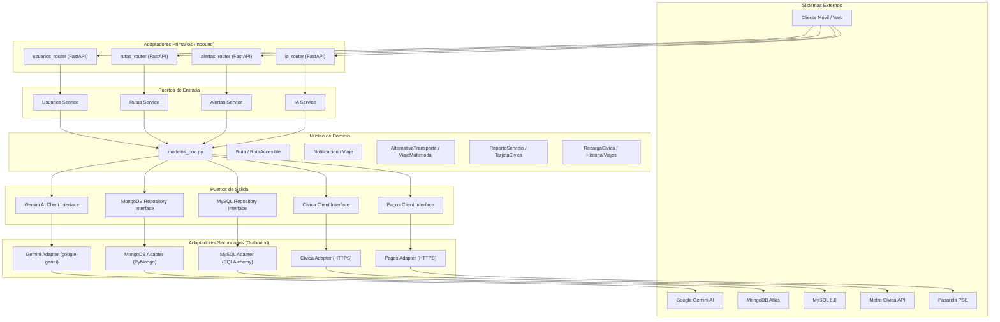

# 🏗️ Arquitectura Hexagonal (Ports & Adapters)

> **Patrón Arquitectónico:** Hexagonal Architecture (Alistair Cockburn)  
> **Estilo:** Domain-Driven Design (DDD) + Separación de Responsabilidades  
> **Aplicación:** TuRutaMed Backend API  

---

## 1. Visión General

La **Arquitectura Hexagonal** (también conocida como *Ports & Adapters*) organiza el sistema en capas concéntricas que protegen el **Núcleo de Dominio** de las dependencias externas (frameworks, bases de datos, APIs de terceros). El objetivo es que la lógica de negocio pueda evolucionar y testearse de forma independiente de la infraestructura.

En TuRutaMed, esto se traduce en una separación estricta entre:

- **Dominio Puro** (`app/domain/`): Entidades y reglas de negocio sin dependencias externas.
- **Puertos y Servicios de Aplicación** (`app/services/`): Orquestación de casos de uso.
- **Adaptadores Primarios** (`app/routers/`): Entrada HTTP (FastAPI).
- **Adaptadores Secundarios** (`app/models/`, `app/database.py`): Salida hacia bases de datos y APIs externas.

---

## 2. Diagrama de la Arquitectura Hexagonal



---

## 3. Capas y Responsabilidades

### 3.1. Núcleo de Dominio (`app/domain/`)

- **Archivo:** `app/domain/modelos_poo.py`
- **Contenido:** 10 entidades POO unificadas (RF-01 a RF-10).
- **Reglas:**
  - Sin imports de frameworks (FastAPI, Pydantic, Motor, SQLAlchemy).
  - Sin dependencias de infraestructura.
  - Contiene las reglas de negocio e invariantes del dominio metropolitano.
  - Es la **Fuente Única de Verdad (DRY)** del sistema.

**Entidades:**
| Entidad | RF | Responsabilidad |
| :--- | :--- | :--- |
| `Ruta` | RF-01 | Catálogo de itinerarios y horarios operativos |
| `RutaAccesible` | RF-09 | Especialización de `Ruta` con atributos PMR |
| `Notificacion` | RF-02 | Alertas de servicio ante retrasos o cierres |
| `Viaje` | RF-03 | Duración estimada de trayecto origen-destino |
| `AlternativaTransporte` | RF-04 | Proximidad de paraderos/estaciones (≤ 2 km) |
| `ViajeMultimodal` | RF-05 | Secuencia ordenada de tramos combinados |
| `ReporteServicio` | RF-06 | Calificaciones y reportes ciudadanos |
| `TarjetaCivica` | RF-07 | Consulta de saldo de tarjeta Cívica |
| `RecargaCivica` | RF-08 | Procesamiento de recargas monetarias |
| `HistorialViajes` | RF-10 | Historial y estadísticas de viajes |

---

### 3.2. Puertos y Servicios de Aplicación (`app/services/`)

- **Responsabilidad:** Orquestar casos de uso, coordinar entidades de dominio y adaptadores secundarios.
- **Puertos de Entrada (Driven Ports):** Interfaces que exponen los casos de uso al exterior.
- **Puertos de Salida (Driver Ports):** Interfaces que el dominio necesita para persistir o consultar datos externos.

**Convención:** Cada servicio de aplicación implementa un caso de uso específico y depende de interfaces abstractas (no de implementaciones concretas).

| Servicio | Caso de Uso |
| :--- | :--- |
| `Usuarios Service` | Registrar, autenticar y autorizar usuarios |
| `Rutas Service` | Consultar rutas, filtrar por accesibilidad, calcular cercanía |
| `Alertas Service` | Registrar y consultar alertas viales |
| `IA Service` | Optimizar itinerarios multimodales con Gemini |

---

### 3.3. Adaptadores Primarios (Inbound / Driving Adapters)

- **Ubicación:** `app/routers/`
- **Tecnología:** FastAPI
- **Responsabilidad:**
  - Recibir solicitudes HTTP (GET, POST, PUT, DELETE).
  - Validar payloads con Pydantic (DTOs).
  - Extraer y validar tokens JWT.
  - Invocar servicios de aplicación.
  - Formatear respuestas HTTP y códigos de estado.

**Adaptadores:**
| Router | Prefijo | Responsabilidad |
| :--- | :--- | :--- |
| `usuarios_router` | `/usuarios` | Registro, login, gestión de usuarios |
| `rutas_router` | `/rutas` | Consulta de rutas y paraderos |
| `alertas_router` | `/alertas` | Reporte y consulta de alertas |
| `ia_router` | `/ia` | Recomendaciones multimodales |

---

### 3.4. Adaptadores Secundarios (Outbound / Driven Adapters)

- **Ubicación:** `app/models/`, `app/database.py`, `app/services/*_adapter.py`
- **Tecnología:** SQLAlchemy, PyMongo, `google-genai`, HTTPS REST
- **Responsabilidad:**
  - Implementar los puertos de salida definidos por el dominio.
  - Gestionar conexiones a bases de datos y APIs externas.
  - Mapear entre modelos de persistencia y entidades de dominio.

**Adaptadores:**
| Adaptador | Tecnología | Responsabilidad |
| :--- | :--- | :--- |
| `MySQL Adapter` | SQLAlchemy ORM | Persistencia de usuarios y roles |
| `MongoDB Adapter` | PyMongo Driver | Persistencia de rutas, alertas y consultas geoespaciales |
| `Gemini Adapter` | `google-genai` SDK | Interacción con Google Gemini 2.5 Flash |
| `Cívica Adapter` | HTTPS REST | Consulta de saldo y recarga Cívica |
| `Pagos Adapter` | HTTPS REST | Procesamiento de recargas monetarias |

---

## 4. Flujo de Dependencias (Regla de Dependencia)

```
Adaptadores Primarios → Puertos de Entrada → Núcleo de Dominio → Puertos de Salida → Adaptadores Secundarios
```

- **Regla fundamental:** Las dependencias siempre apuntan hacia el interior (hacia el dominio).
- El dominio **no conoce** a los adaptadores ni a los frameworks.
- Los adaptadores **dependen** de las interfaces definidas por el dominio y los puertos.

---

## 5. Beneficios de la Arquitectura Hexagonal en TuRutaMed

1. **Testabilidad:** El dominio se puede probar de forma aislada sin bases de datos ni servidores HTTP.
2. **Flexibilidad:** Se pueden cambiar adaptadores (ej. MongoDB por PostgreSQL) sin modificar el dominio.
3. **Escalabilidad:** Los servicios de aplicación pueden escalar independientemente.
4. **Mantenibilidad:** La lógica de negocio está centralizada y protegida de cambios de infraestructura.
5. **Evolución:** Nuevas funcionalidades se agregan como nuevos puertos/adaptadores sin romper el núcleo.

---

## 6. Estructura de Directorios Recomendada

```
app/
├── core/                  # Configuración global y manejo de excepciones
│   ├── seguridad.py       # JWT, hashing, RBAC
│   └── exceptions.py      # Manejador centralizado de excepciones
├── domain/                # Núcleo de Dominio (POO puro)
│   └── modelos_poo.py     # 10 entidades de negocio unificadas
├── models/                # Adaptadores Secundarios (Persistencia)
│   ├── usuario.py         # SQLAlchemy ORM (MySQL)
│   ├── ruta_mongo.py      # PyMongo (MongoDB)
│   └── alerta_mongo.py    # PyMongo (MongoDB)
├── routers/               # Adaptadores Primarios (HTTP)
│   ├── usuarios_router.py
│   ├── rutas_router.py
│   ├── alertas_router.py
│   └── ia_router.py
├── services/              # Puertos y Servicios de Aplicación
│   ├── usuarios_service.py
│   ├── rutas_service.py
│   ├── alertas_service.py
│   ├── ia_service.py
│   ├── gemini_service.py  # Adaptador Gemini
│   ├── civica_service.py  # Adaptador Cívica
│   └── pagos_service.py   # Adaptador Pagos
└── database.py            # Gestión de conexiones (MySQL + MongoDB)
```

---

## 7. Convenciones de Implementación

1. **Tipado Estricto:** Todo código usa type hints explícitos (`str`, `int`, `float`, `bool`, `List`, `Optional`, `Dict`).
2. **Sin Lógica en Adaptadores:** Los routers solo validan y delegan; la lógica reside en servicios y dominio.
3. **Validación en los Bordes:** Pydantic valida en adaptadores primarios; el dominio asume datos válidos.
4. **Excepciones Centralizadas:** Todas las excepciones se manejan en `app/core/exceptions.py` con códigos REST semánticos.
5. **Fuente Única de Verdad:** Las entidades de dominio no se duplican; se reutilizan en todos los servicios.