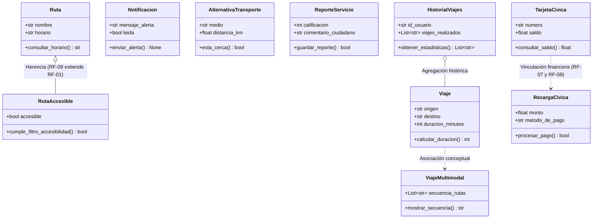

# 🧬 Especificación del Modelo de Dominio (Domain Model)

> **Capa:** Núcleo de Dominio (Domain Core / POO)  
> **Archivo Fuente de Verdad:** `app/domain/modelos_poo.py`  
> **Patrón Arquitectónico:** Arquitectura Hexagonal / Domain-Driven Design (DDD)  
> **Tipado:** Python 3.11+ Estricto (`str`, `int`, `float`, `bool`, `List`)  

---

## 1. Visión y Principios del Dominio

El modelo de dominio de **TuRutaMed** representa las entidades y reglas de negocio cardinales del transporte público del Valle de Aburrá. Siguiendo el principio de **Arquitectura Hexagonal**, este módulo está completamente desacoplado de dependencias externas (sin imports de FastAPI, Motor, Pydantic o SQLAlchemy).

El archivo `app/domain/modelos_poo.py` constituye la **Fuente Única de Verdad (Single Source of Truth - DRY)** para los Requisitos Funcionales **RF-01** a **RF-10**.

---

## 2. Diagrama de Clases UML (Mermaid)

---

## 3. Especificación Detallada de las 10 Entidades de Dominio

### 3.1. `Ruta` (Requisito Funcional: RF-01)
- **Propósito:** Representa una línea o trazado formal de transporte del sistema público (buses, Metro, Tranvía, Metroplús).
- **Atributos:**
  - `nombre: str`: Nombre descriptivo e identificador de la ruta (p. ej., *"Línea A: Niquía - La Estrella"* o *"Manrique Oriental - Centro"*).
  - `horario: str`: Ventana horaria de operación continua (p. ej., *"05:00 - 23:00"*).
- **Métodos:**
  - `consultar_horario() -> str`: Retorna el formato estandarizado que asocia el nombre de la ruta con su franja operativa.
- **Regla de Negocio / Invariante:** No pueden existir rutas con horarios nulos; la consulta entrega el itinerario en formato legible para pantallas informativas y aplicaciones móviles.

---

### 3.2. `RutaAccesible` (Requisito Funcional: RF-09)
- **Propósito:** Especialización de la clase base `Ruta` que incluye adaptaciones técnicas para Personas con Movilidad Reducida (PMR) o discapacidades visuales/auditivas.
- **Relación UML:** Herencia (`class RutaAccesible(Ruta)`).
- **Atributos:**
  - Atributos heredados: `nombre: str`, `horario: str`.
  - `accesible: bool`: Bandera booleana que acredita si la flota o estación cuenta con rampas, elevadores o buses de piso bajo.
- **Métodos:**
  - `cumple_filtro_accesibilidad() -> bool`: Verifica si la ruta satisface las exigencias de accesibilidad universal para personas en condición de discapacidad.
- **Regla de Negocio / Invariante:** Permite a los motores de búsqueda descartar rutas con barreras arquitectónicas cuando el pasajero activa el filtro de accesibilidad.

---

### 3.3. `Notificacion` (Requisito Funcional: RF-02)
- **Propósito:** Gestiona las alertas operativas originadas por incidentes de tránsito, cierres viales, mantenimiento técnico o factores climáticos.
- **Atributos:**
  - `mensaje_alerta: str`: Cuerpo descriptivo de la eventualidad o novedad de servicio.
  - `leida: bool`: Indicador de estado que inicia por defecto en `False`.
- **Métodos:**
  - `enviar_alerta() -> None`: Ejecuta el despacho de la notificación hacia los canales de difusión (Push/Socket/Terminal).
- **Regla de Negocio / Invariante:** Toda notificación nace en estado no leída (`leida = False`) y su contenido debe ser explícito e inequívoco.

---

### 3.4. `Viaje` (Requisito Funcional: RF-03)
- **Propósito:** Modela el trayecto monomodal o desplazamiento directo entre dos puntos geográficos dentro de la urbe.
- **Atributos:**
  - `origen: str`: Nombre o georreferencia del punto de partida (p. ej., *"Poblado"*).
  - `destino: str`: Nombre o georreferencia del punto de arribo (p. ej., *"Niquía"*).
  - `duracion_minutos: int`: Estimación de tiempo requerido para completar el viaje en condiciones normales de tráfico.
- **Métodos:**
  - `calcular_duracion() -> int`: Retorna la cantidad entera de minutos proyectada para el trayecto.
- **Regla de Negocio / Invariante:** La duración en minutos debe ser un valor entero positivo mayor a cero.

---

### 3.5. `AlternativaTransporte` (Requisito Funcional: RF-04)
- **Propósito:** Modela estaciones, paraderos o modos de locomoción situados en un radio cercano a la posición del usuario.
- **Atributos:**
  - `medio: str`: Tipo de transporte disponible (*"Metro"*, *"Metrocable"*, *"Encicla"*, *"Bus Urbano"*).
  - `distancia_km: float`: Distancia geodésica o caminable expresada en kilómetros hacia el nodo.
- **Métodos:**
  - `esta_cerca() -> bool`: Evalúa si la distancia hacia el medio es menor o igual al umbral máximo de caminabilidad peatonal urbana ($\le 2.0\text{ km}$).
- **Regla de Negocio / Invariante:** Se considera alternativa cercana todo medio localizado a una distancia $\le 2.0\text{ km}$; distancias superiores quedan excluidas del catálogo prioritario.

---

### 3.6. `ViajeMultimodal` (Requisito Funcional: RF-05)
- **Propósito:** Orquesta itinerarios combinados que requieren transferencia entre distintos subsistemas integrados (Metro + Metrocable + Alimentador).
- **Atributos:**
  - `secuencia_rutas: List[str]`: Lista indexada y ordenada cronológicamente de los segmentos que componen la ruta.
- **Métodos:**
  - `mostrar_secuencia() -> str`: Formatea el itinerario uniendo los tramos mediante el conector `" -> "` con el prefijo `"Ruta sugerida: "`.
- **Regla de Negocio / Invariante:** La lista debe contener al menos dos tramos conectados para constituir un viaje multimodal válido.

---

### 3.7. `ReporteServicio` (Requisito Funcional: RF-06)
- **Propósito:** Captura la retroalimentación y evaluación comunitaria del estado de los vehículos y la puntualidad del servicio.
- **Atributos:**
  - `calificacion: int`: Escala numérica entera de satisfacción ciudadana (típicamente 1 a 5 estrellas).
  - `comentario_ciudadano: str`: Reseña textual o detalle cualitativo provisto por el usuario.
- **Métodos:**
  - `guardar_reporte() -> bool`: Confirma el almacenamiento exitoso del reporte para su procesamiento analítico.
- **Regla de Negocio / Invariante:** Las calificaciones admiten valores dentro del rango $[1, 5]$.

---

### 3.8. `TarjetaCivica` (Requisito Funcional: RF-07)
- **Propósito:** Modela el soporte físico o digital con chip sin contacto utilizado para el cobro electrónico de pasajes en el Metro de Medellín.
- **Atributos:**
  - `numero: str`: Identificador alfanumérico único impreso en la tarjeta o asociado a la billetera digital.
  - `saldo: float`: Cantidad monetaria disponible en pesos colombianos (COP).
- **Métodos:**
  - `consultar_saldo() -> float`: Retorna el monto disponible para realizar viajes en la red.
- **Regla de Negocio / Invariante:** El saldo devuelto debe reflejar de forma exacta el estado contable de la tarjeta.

---

### 3.9. `RecargaCivica` (Requisito Funcional: RF-08)
- **Propósito:** Modela la intención de pago y acreditación de saldo monetario hacia una tarjeta de transporte.
- **Atributos:**
  - `monto: float`: Valor monetario en COP a acreditar en la cuenta Cívica.
  - `metodo_de_pago: str`: Pasarela o medio seleccionado (*"PSE"*, *"Bancolombia"*, *"Nequi"*, *"Tarjeta Crédito"*).
- **Métodos:**
  - `procesar_pago() -> bool`: Ejecuta la confirmación del pago contra la pasarela financiera.
- **Regla de Negocio / Invariante:** El monto a recargar debe ser un valor positivo mayor a cero y soportado por pasarelas autorizadas.

---

### 3.10. `HistorialViajes` (Requisito Funcional: RF-10)
- **Propósito:** Agrupa los registros históricos de desplazamientos y frecuencias de movilidad asociadas a la cuenta de un pasajero.
- **Atributos:**
  - `id_usuario: str`: Identificador unívoco del usuario o cuenta en el sistema.
  - `viajes_realizados: List[str]`: Colección secuencial de descripciones o identificadores de viajes completados.
- **Métodos:**
  - `obtener_estadisticas() -> List[str]`: Recupera el listado completo de viajes para cómputo de métricas y visualización de hábitos de viaje.
- **Regla de Negocio / Invariante:** Preserva la cronología de los desplazamientos asociados exclusivamente al `id_usuario`.
